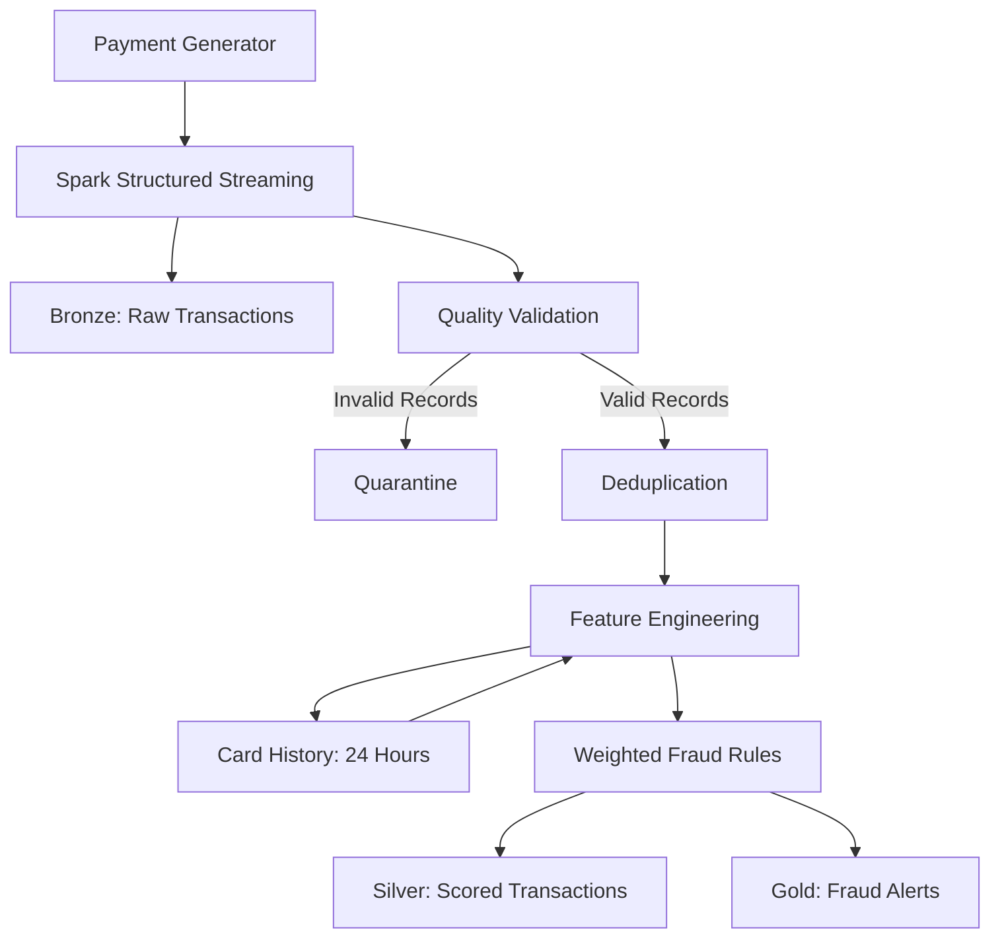

# Real-Time Card Fraud Detection Pipeline

A real-time fraud detection pipeline that identifies suspicious card transactions using **PySpark Structured Streaming** and **Delta Lake**. The project implements a medallion architecture, data quality validation, explainable fraud detection rules, and idempotent processing.

## The Problem

Banks need to detect fraudulent transactions as they happen. Stolen cards may be tested with small payments before being used for larger transactions, or used rapidly across different countries.

Batch processing can be too slow for these scenarios. A fraud detection system must identify suspicious patterns, explain why a transaction was flagged, and avoid duplicate alerts when data is replayed or a job restarts.

## Architecture

## Medallion Data Architecture

| Layer | Purpose |
|---|---|
| Bronze | Stores raw transactions as received, including source-file information and ingestion timestamps. |
| Quarantine | Stores invalid records with rejection reasons for investigation and troubleshooting. |
| Silver | Stores validated, typed, deduplicated transactions with calculated features and risk scores. |
| Gold | Stores fraud alerts, risk scores, and the rules triggered for each alert. |
| Card History | Maintains recent transaction history to detect patterns across multiple micro-batches. |

## Fraud Detection Rules

The pipeline uses weighted, explainable business rules rather than an opaque machine-learning model.

| Rule | Condition | Points |
|---|---|---:|
| Velocity | More than 5 payments within 10 minutes | 50 |
| Card Testing | 3 or more payments of £2 or less within 10 minutes | 55 |
| Impossible Travel | At least 100 km between in-person payments with a calculated speed above 900 km/h | 50 |
| Amount Anomaly | Transaction amount is at least €200 and the customer's amount z-score is 4 or higher | 30 |
| High-Risk Merchant Category | Spending in selected high-risk categories is at least 3 times the usual amount | 20 |
| Foreign Card Present | In-person payment occurs outside the customer's home country | 15 |

A transaction becomes a fraud alert when its accumulated risk score reaches **50 points**. Each alert records its triggered rules and rules version to support explainability and auditing.

## Key Engineering Decisions

- **Exactly-once processing:** Uses Delta Lake transaction identifiers, merge operations, and deduplication to prevent duplicate records and alerts during retries.
- **Stateful feature engineering:** Uses recent card history so suspicious patterns can be identified across different micro-batches.
- **Window functions:** Uses time-based windows for transaction velocity and recent activity.
- **Data quality:** Validates incoming records and quarantines invalid data with explicit rejection reasons.
- **Financial precision:** Uses decimal types for monetary values instead of relying on floating-point arithmetic.
- **Efficient joins:** Uses broadcast joins where appropriate for small customer reference datasets.
- **Replayable ingestion:** Tracks source files and batch identifiers to support controlled reprocessing.

## Project Results

The following results are reported by the current synthetic-data evaluation and should be reproduced by running the pipeline before being treated as verified benchmarks.

| Metric | Reported result |
|---|---:|
| Synthetic transactions | 909 |
| Customers | 200 |
| Fraudulent payments | 47 |
| Compromised cards detected | 10 of 10 |
| Precision | 89% (31 of 35 alerts were genuine fraud) |
| Recall | 66% (31 of 47 fraudulent payments detected) |
| Duplicate alerts after replay | 0 |

Recall is below 100% because some fraud patterns become detectable only after multiple transactions have occurred. For example, a card-testing pattern may be identified only after the third